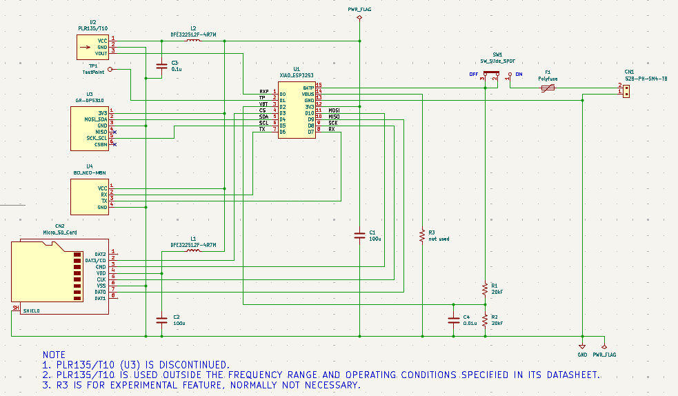
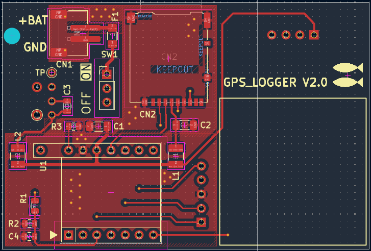
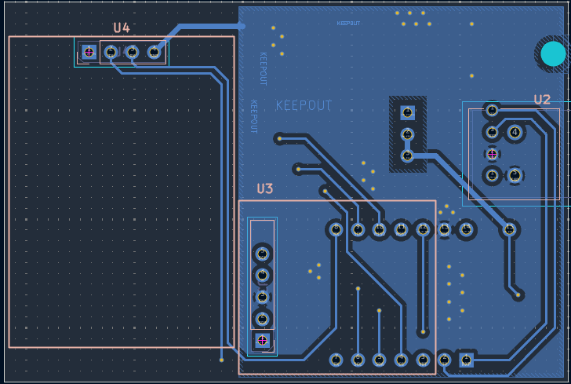
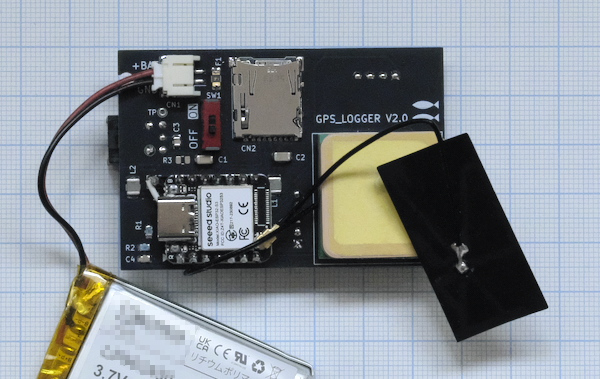
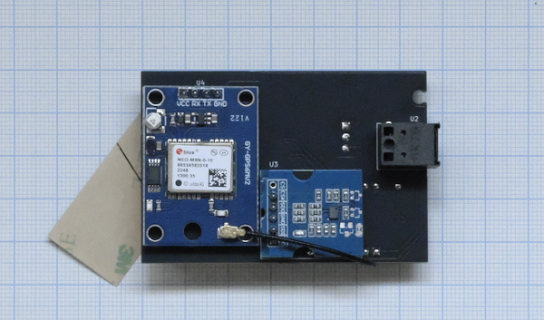

# cloud_bridge_gps_logger

## 内容 / Contents
- `cloud_bridge_gps_logger` :  
UART入力付きGNSSデータロガー / GNSS data logger with UART input  
使用したボード： XIAO ESP32S3 / Applied board: XIAO ESP32S3  
Blog:  https://inte-gonext.hatenablog.com/entry/2026/10/23/104821  
 

---
## 参考 / references

回路図、パターン図 / schematic and PCB layout  
  
  
  
 
基板の写真 / PCB photos  
  
  
 

---

## License
Copyright (c) 2026 inteGN - MIT License  
The schematic and PCB layout included in this repository are provided under the MIT License, equivalent to the terms applied to the software.  

